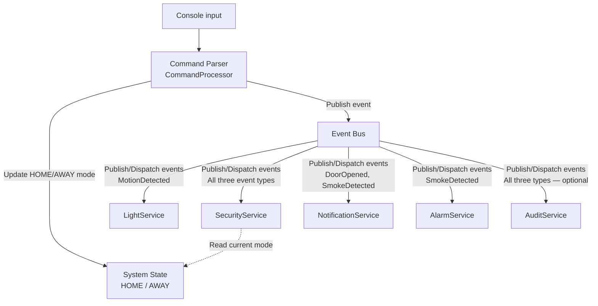

## Requirements and setup

- Python 3.9 or newer.
- Python standard library only.

From the project root, create and activate a virtual environment (macOS/Linux):

```bash
python3 -m venv .venv
source .venv/bin/activate
```

When finished, run `deactivate`.

## Run the application

```bash
python3 main.py
```

The system starts in **HOME** mode. Interactive sessions display a prompt; input
redirected from a file produces plain output. Enter `help` to list commands.

| Command | Example | Effect |
| --- | --- | --- |
| `mode home` | `mode home` | Set HOME mode |
| `mode away` | `mode away` | Set AWAY mode |
| `motion <location>` | `motion living_room` | Publish MotionDetected |
| `door_open <door>` | `door_open front_door` | Publish DoorOpened |
| `smoke <location>` | `smoke kitchen` | Publish SmokeDetected |
| `help` | `help` | Display commands |
| `exit` | `exit` | Terminate |

Use underscores for names containing spaces. Blank lines are ignored.


## Run the assignment sample

```bash
python3 main.py < data/sample_input.txt
```

Input:

```text
mode away
motion living_room
door_open front_door
smoke kitchen
exit
```

Expected output is checked in at
[`data/sample_output.txt`](data/sample_output.txt).

Its event blocks match the assignment sample: motion turns on the light and
raises an AWAY alert; opening the door raises an AWAY alert and notification;
smoke activates all three emergency consumers.

Additional scenarios:

```bash
python3 main.py < data/home_input.txt
python3 main.py < data/mode_switch_input.txt
python3 main.py < data/invalid_input.txt
```

HOME produces no motion or unauthorized-entry alerts. Smoke always activates
the alarm, emergency notification, and security record, regardless of mode.

## Architecture and event flow



1. `main.py` invokes the CLI entry point.
2. `app.py` creates the state, bus, and services, and registers subscriptions.
3. `CommandProcessor` validates a line and constructs an event with an aware UTC
   timestamp. It only knows the bus and state; it never invokes a consumer.
4. `EventBus.publish()` delivers the event to every registered subscriber for
   that exact event type, in registration order.
5. Each service performs its own business action. Security reads the shared mode.
6. The console waits for the next command after delivery completes.

The bus is synchronous. Publish/subscribe communication does not require parallel
execution. Synchronous processing also ensures that each event finishes before a
later command changes the mode. No consumer calls another consumer.

| Event | Subscriber | Business action |
| --- | --- | --- |
| MotionDetected | LightService | Turn on the light in the specified location |
| MotionDetected | SecurityService | Record motion; generate a security alert if AWAY |
| DoorOpened | SecurityService | Record the door opening; generate an unauthorized-entry alert if AWAY |
| DoorOpened | NotificationService | Generate a door-open notification |
| SmokeDetected | AlarmService | Activate the fire alarm |
| SmokeDetected | NotificationService | Generate an emergency notification |
| SmokeDetected | SecurityService | Record the smoke emergency |


## Demonstrate loose coupling

```bash
python3 main.py --audit < data/sample_input.txt
```

`AuditService` is an additional subscriber to all three existing event types.
It records each event and prints a line such as:

```text
AuditService: MotionDetected received at 2026-10-15T12:00:00+00:00.
```

## Failure Handling

The Event Bus handles consumer failures independently, ensuring that one failing subscriber does not prevent other subscribers from processing the event.

Run the failure demonstration:

```bash
python3 main.py --demo-failure < data/sample_input.txt
```

If a consumer fails, the Event Bus logs the error and continues delivering the event to the remaining subscribers.
